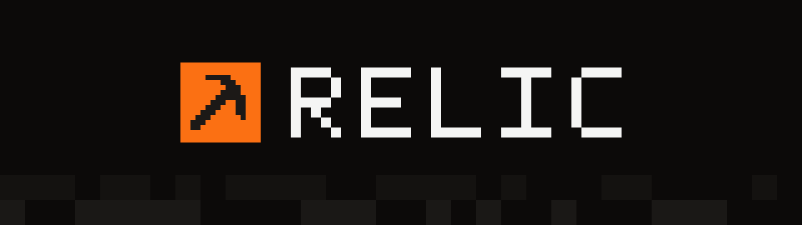
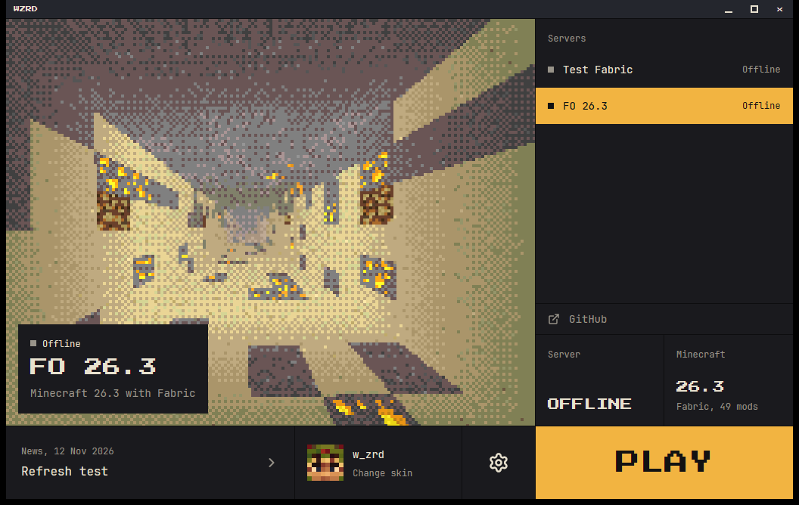
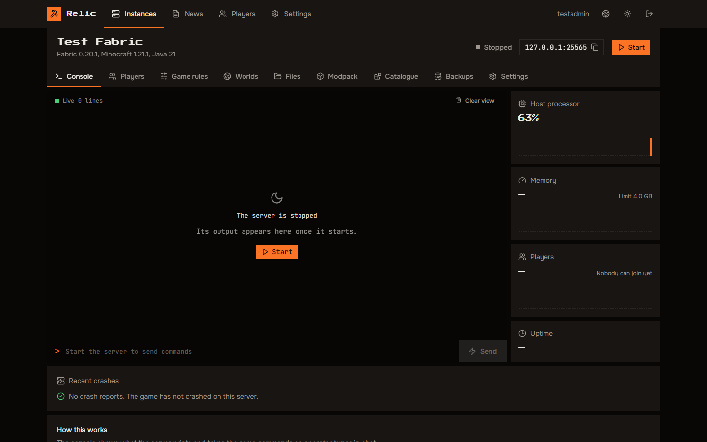
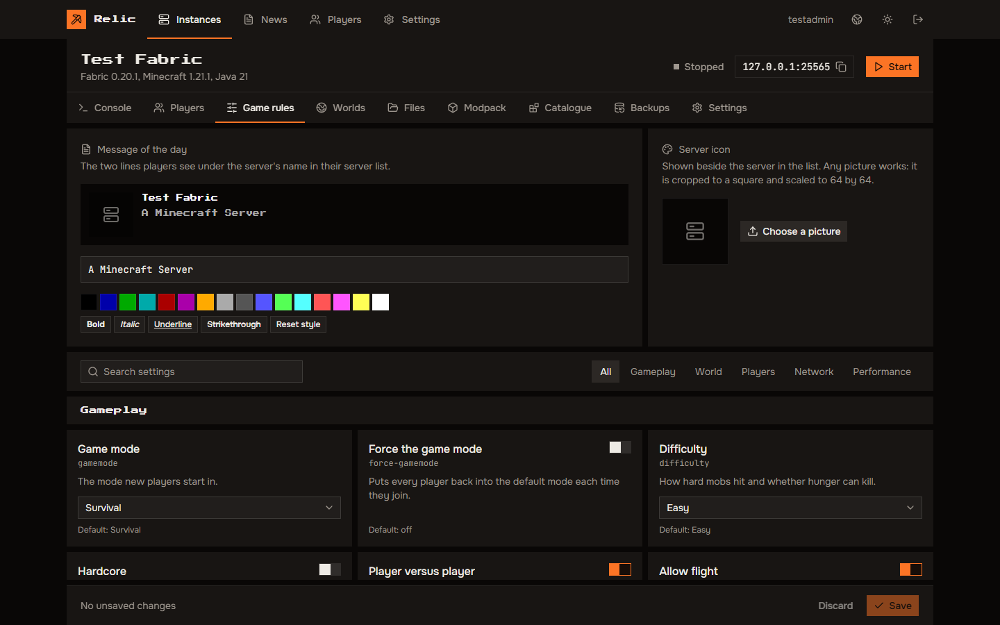
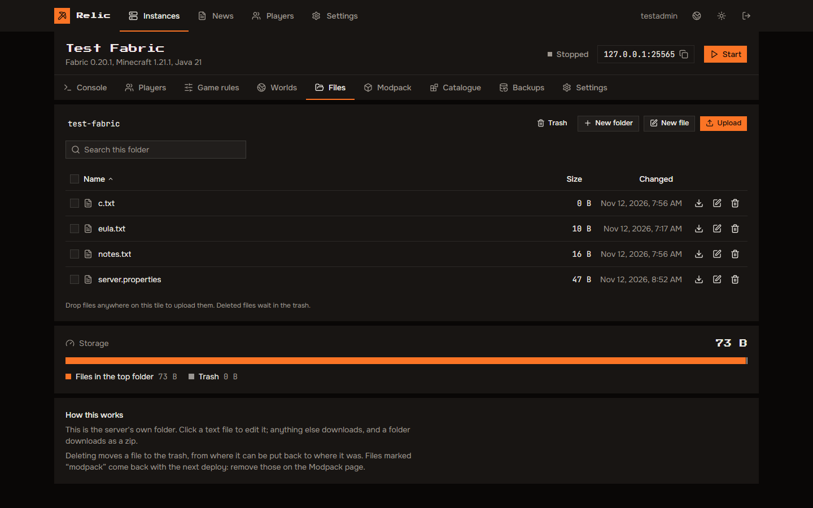
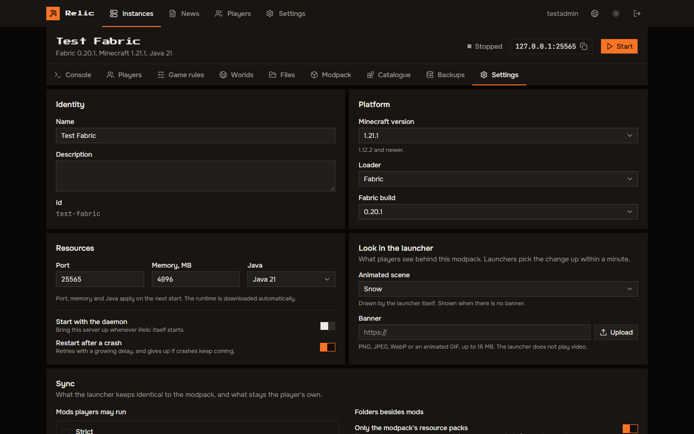

<p align="center">
  
</p>

<p align="center">
  A self-hosted daemon and launcher for private modded Minecraft servers.
</p>

<p align="center">
  <a href="https://github.com/redstone-md/relic/actions/workflows/ci.yml"></a>
  <a href="https://github.com/redstone-md/relic/releases/latest"></a>
  <a href="LICENSE"></a>
  
</p>

Relic keeps a modded server and its players on the same modpack. You run one
daemon on your machine; it installs and supervises the Minecraft servers,
serves the modpack, holds the player accounts and carries its own admin panel.
Players get one launcher: they type your address, sign in and press Play. The
launcher installs the game, the loader and Java, downloads only the files that
changed and starts the game.

<p align="center">
  
</p>

## What it does

**Daemon** (`admin-core`)

- Runs several Minecraft servers side by side, each with its own version,
  loader, port, memory limit and modpack.
- Installs the server jar, Fabric, Quilt, Forge or NeoForge and the matching
  Temurin Java runtime by itself. Minecraft 1.12.2 and newer.
- Live console, automatic restart after a crash with a growing delay, crash
  reports, scheduled world backups.
- A file manager with a trash, a game-rules editor, worlds and player lists.
- Mods from an upload, a `.mrpack` import, or a search of Modrinth and
  CurseForge. Each jar is inspected to tell client-only, server-only and
  shared mods apart.
- Player accounts with invites, skins and capes. Servers and clients
  authenticate against the daemon through
  [authlib-injector](https://github.com/yushijinhun/authlib-injector).
- One binary with the panel inside; all state in one folder, SQLite included.

**Launcher** (`relic-launcher`)

- Finds the daemon from a domain name, then shows your servers, news and links.
- Installs Minecraft, the loader and Java into its own folder and leaves the
  system alone.
- Syncs the modpack by SHA-256: downloads what changed, removes what was
  dropped, resumes interrupted downloads. Optional mods are the player's
  choice; what else players may add is a per-server policy.
- Takes its background scene or banner from the server.
- Updates itself from GitHub releases and refuses a build that is not signed
  with the project's key.
- Windows, Linux and macOS. English and Russian.

## Screenshots

| | |
|---|---|
|  |  |
|  |  |

## Run the daemon

Grab `relic-admin-*` for your system from the
[releases page](https://github.com/redstone-md/relic/releases) and start it:

```sh
RELIC_DATA_DIR=/var/lib/relic RELIC_BIND=127.0.0.1:8080 ./relic-admin-linux-x86_64
```

The first start prints a one-time setup token. Open the panel at the address
you bound, paste the token and create the administrator account. From there
the panel walks you through the first server.

| Variable | Default | Meaning |
|---|---|---|
| `RELIC_DATA_DIR` | `./data` | Where the database, mods, servers and backups live |
| `RELIC_BIND` | `0.0.0.0:8080` | Address of the panel and the launcher API |
| `RELIC_TRUST_PROXY` | off | Set to `1` behind a reverse proxy so rate limits see real client addresses |

### Docker

```sh
docker run -d --name relic \
  -p 8080:8080 -p 25565:25565 \
  -v relic-data:/data \
  ghcr.io/redstone-md/relic:latest

docker logs relic   # the setup token is here
```

Publish one more port for every extra server you create.

### systemd

[`deploy/relic.service`](deploy/relic.service) is a hardened unit; the
commands to install it are at the top of the file.

### TLS

The launcher talks to the daemon over HTTPS. Put a reverse proxy that
terminates TLS (Caddy, nginx, Traefik) in front of port 8080 and set
`RELIC_TRUST_PROXY=1`. Players type the domain; an optional
`_mcadmin._tcp` SRV record lets the panel live on another host or port.

## Give players the launcher

Send them `relic-launcher-*` from the same release. On first start it asks for
your domain and an invite code, if your registration policy needs one.

## Build from source

You need Rust 1.88 or newer, Node 22 and pnpm 9. On Linux the launcher also
needs the development packages listed in
[`.github/workflows/ci.yml`](.github/workflows/ci.yml).

```sh
# The daemon embeds the panel, so build that first.
cd web && pnpm install --frozen-lockfile && pnpm build && cd ..

cargo build --release -p admin-core
cargo build --release -p launcher-client   # binary: relic-launcher
```

For work on the panel, run the daemon and then `pnpm dev` in `web/`; requests
to `/api` are proxied to `127.0.0.1:8080` (change it with `RELIC_DEV_API`).

```
crates/
  relic-proto       types shared by the daemon and the launcher
  relic-jar         reads mod metadata out of jars
  relic-mc          installs Minecraft, loaders and Java
  admin-core        the daemon
  launcher-client   the launcher
web/                the admin panel (React, built into the daemon)
deploy/             systemd unit
docs/               product requirements (in Russian), images
```

## Releases and signing

Pushing a tag `vX.Y.Z` that matches the version in `Cargo.toml` builds every
binary, signs each one with [minisign](https://jedisct1.github.io/minisign/)
and publishes a GitHub release with `SHA256SUMS`. The public key is compiled
into the launcher, so only releases signed with the matching secret key are
accepted as updates.

A fork that wants its own update channel needs its own key pair:

```sh
minisign -G -W -p relic.pub -s relic.key
```

Store the contents of `relic.key` as the repository secret
`MINISIGN_SECRET_KEY` and the base64 line of `relic.pub` as the repository
variable `MINISIGN_PUBLIC_KEY`.

To check a download by hand:

```sh
minisign -Vm relic-admin-linux-x86_64 -P <public key>
```

## What you are trusting

A Relic server hands its players code to run: mods, and the Java that runs
them. A player who types a domain into the launcher trusts whoever runs that
domain, the same way they would trust a modpack downloaded from them. Run the
daemon behind TLS, and only join servers run by people you know.

Security problems go through a
[private report](https://github.com/redstone-md/relic/security/advisories/new);
see [SECURITY.md](SECURITY.md).

## Contributing

Bug reports and pull requests are welcome. [CONTRIBUTING.md](CONTRIBUTING.md)
covers the setup and the checks CI runs.

## Credits

- Block textures in the launcher scenes come from the resource pack
  [Trailers Vision](https://modrinth.com/resourcepack/trailers-vision) by
  DiamondIsntHere and Roxtro, CC BY 4.0.
- [Press Start 2P](https://fonts.google.com/specimen/Press+Start+2P) by
  CodeMan38 and [JetBrains Mono](https://www.jetbrains.com/lp/mono/) by
  JetBrains, both under the SIL Open Font License 1.1.

Details are in
[`crates/launcher-client/assets/CREDITS.md`](crates/launcher-client/assets/CREDITS.md).

## License

[MIT](LICENSE).

Relic is not an official Minecraft product and is not approved by or
associated with Mojang or Microsoft. It ships no game files; the game is
downloaded from Mojang's servers on the player's machine.
